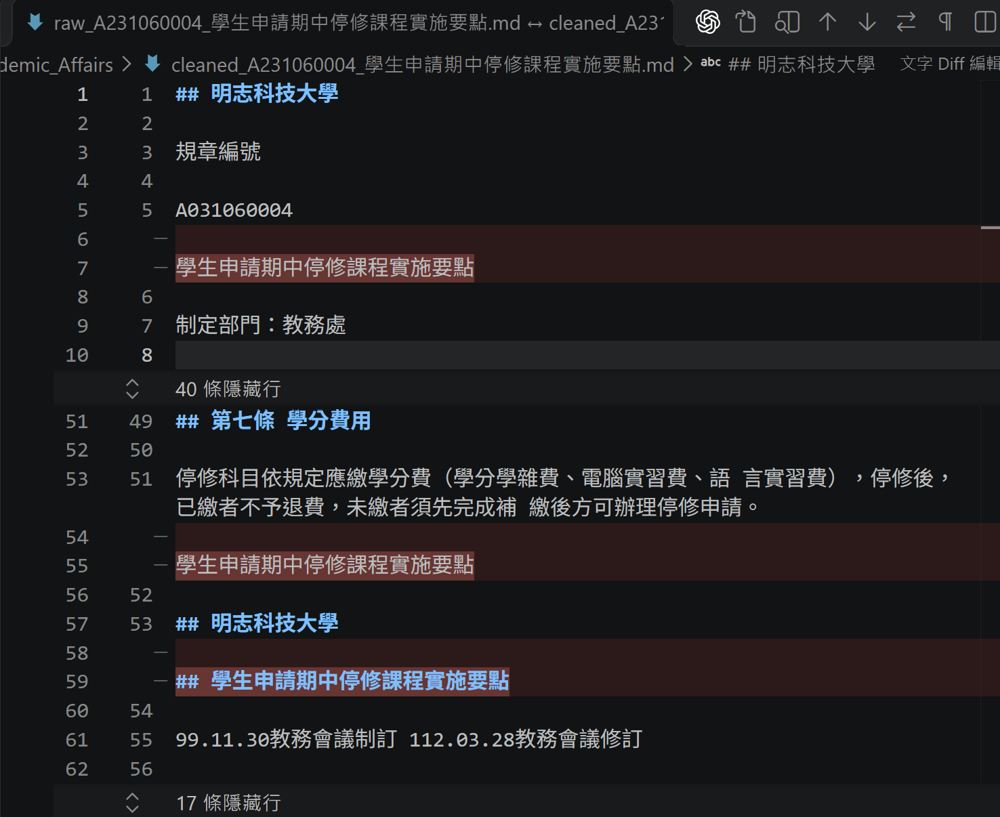
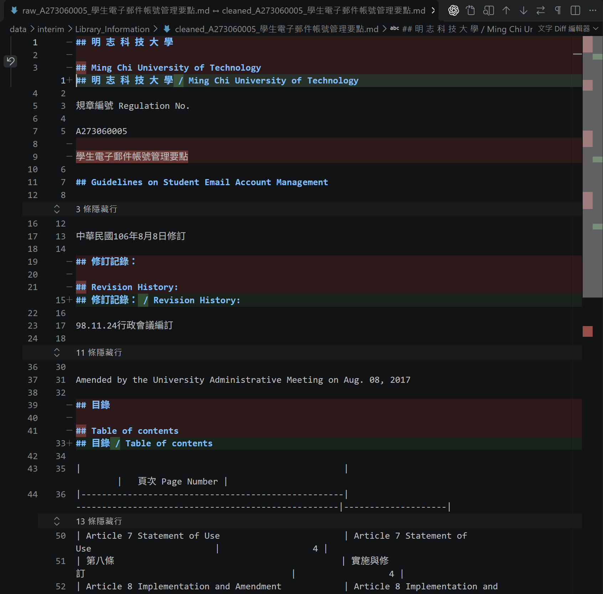
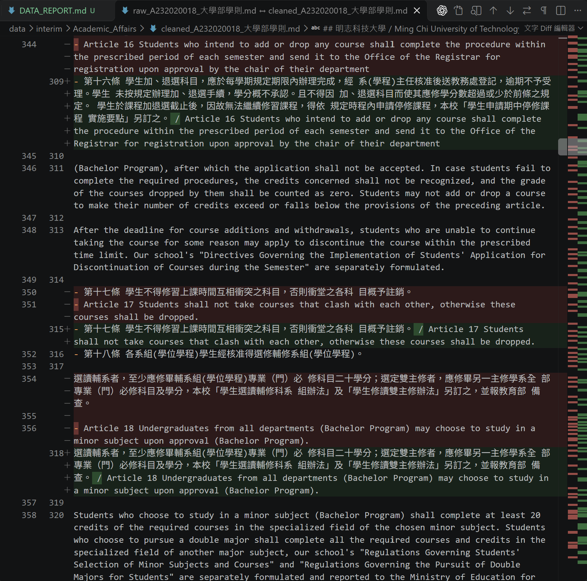
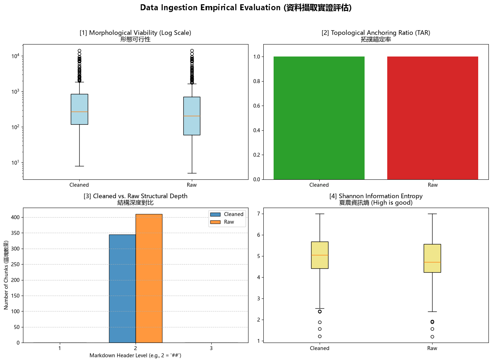

# 資料前處理報告 (Data Preparation Report)

- **學號 / 姓名**：_U12627017 徐淳葳_
- **專案名稱**：_nlp-mcut-qa-system_
- **完成的任務**：- [x] 1-A 頁首頁尾清除　- [x] 1-B 雙語標題合併　- [x] 1-C 雙語條文合併

---

## 1. 資料集概覽 (Dataset Overview)

| 類別 (Cluster) | PDF 數量 | 清洗前 chunk 數 | 清洗後 chunk 數 |
|---|---|---|---|
| Academic_Affairs | 3 | 96 | 65 |
| Library_Information | 3 | 248 | 225 |
| Student_Affairs | 3 | 66 | 55 |
| **合計** | 9 | 410 | 345 |

**問題 (2–3 句)：** 清洗後 chunk 數量變少了多少？是哪個任務造成的？有沒有哪個任務**不影響** chunk 數量？為什麼？

清洗後由 410 個減為 345 個，共減少 65 個 chunk，約減少 15.85%。依 notebook 第 5 節的清洗規則逐步重算，數量為 `410 → 396 → 345 → 345`，1-A 減少 14 個，1-B 再減少 51 個。切塊規則是 `r'\n(?=##\s)'`，1-C 合併條文內文但沒有改變本次的 `##` 邊界，因此不影響 chunk 數量。

## 2. 清洗步驟 (Cleaning Steps)

### 2.1 任務 1-A：頁首頁尾溢出清除

- 檔名：`Academic_Affairs/raw_A231060004_學生申請期中停修課程實施要點.md` 與同目錄 `cleaned_A231060004_學生申請期中停修課程實施要點.md`　搜尋的文字：`學生申請期中停修課程實施要點`，對照 raw 第 55、59 行與 cleaned 第 51–55 行附近
- 截圖 (存為 `reports/figures/1a_compare.png`)：
- 改變了什麼：移除 raw 第 55 行整行只有法規名稱的文字，以及第 59 行的 `## 學生申請期中停修課程實施要點`，清洗後直接銜接後面的內容。
- 這對之後的問答檢索有什麼幫助：減少重複頁首文字與多餘 chunk，降低檢索到排版雜訊的機會；實際改善程度仍需以檢索實驗確認。
- 這個任務有沒有**改錯**的地方 (把不該改的也改了)？若有，寫出檔名與搜尋的文字；若沒有，寫「沒有發現」：可能有誤刪：同份 raw 第 7 行、位於文件開頭的法規名稱也被刪除。搜尋「學生申請期中停修課程實施要點」可核對；規則沒有區分正式標題與重複頁首，是否誤刪仍需對照原 PDF 版面。

### 2.2 任務 1-B：雙語標題合併

- 檔名：`Library_Information/raw_A273060005_學生電子郵件帳號管理要點.md` 與同目錄 `cleaned_A273060005_學生電子郵件帳號管理要點.md`　搜尋的文字：`修訂記錄：`，對照 raw 第 19、21 行與 cleaned 第 15 行
- 截圖 (存為 `reports/figures/1b_compare.png`)：
- 改變了什麼：將 `## 修訂記錄：` 與相鄰的 `## Revision History:` 合併成 `## 修訂記錄： / Revision History:`，移除第二個標題的 `##`。
- 這對之後的問答檢索有什麼幫助：讓同一主題的中英文標題留在同一個 chunk，保留兩種語言的檢索詞，並減少只有標題的碎片。
- 這個任務有沒有**改錯**的地方 (把不該改的也改了)？若有，寫出檔名與搜尋的文字；若沒有，寫「沒有發現」：有。`Academic_Affairs/cleaned_A232060013_學生抵免學分辦法.md` 第 191 行，搜尋「Article 4 Principles of Course Waiver and Credit Transfer」，可看到兩個英文標題被合併；原始檔第 201、203 行原本是兩個獨立標題。

### 2.3 任務 1-C：雙語條文合併

- 檔名：`Academic_Affairs/raw_A232020018_大學部學則.md` 與同目錄 `cleaned_A232020018_大學部學則.md`　搜尋的文字：`第十七條` 或 `Article 17`，對照 raw 第 350、351 行與 cleaned 第 315 行
- 截圖 (存為 `reports/figures/1c_compare.png`)：
- 改變了什麼：將第十七條「學生不得修習上課時間互相衝突之科目」與緊接的英文 Article 17 合併，以 ` / ` 分隔並移除英文的清單前綴。
- 這對之後的問答檢索有什麼幫助：使對照文字相鄰，方便閱讀及後續內容處理；本次依 `##` 切塊，因此這一步沒有減少 chunk 數量。
- 這個任務有沒有**改錯**的地方 (把不該改的也改了)？若有，寫出檔名與搜尋的文字；若沒有，寫「沒有發現」：有。同份 cleaned 第 214 行，搜尋「formula-not-decoded」，可看到 `<!-- formula-not-decoded --> / Article 1 The Academic Regulations for Undergraduate Studies`。raw 第 228 行的轉換失敗註記與第 230 行的英文條文被合併，顯示規則沒有要求前一行必須是對應的中文條文。

## 3. 評估指標與 AI 解讀查證 (Metrics & Verifying the AI's Interpretation)

### 3.1 指標數據表

| 指標 | Raw | Cleaned (你的) | Cleaned (參考值) |
|---|---|---|---|
| [1] 中位數長度 Median Length | 204 | 272 | 270.5 |
| [2] 拓撲錨定率 TAR | 1.0 | 1.0 | 1.0 |
| [3] 深度變異量 SDV (選填) | 0 | 0 | 0 |
| [4] 中位數資訊熵 Entropy (選填) | 4.714877 | 5.048404 | 5.062317 |



你的 Cleaned 結果與參考值一致嗎？若一致，寫「一致」；若不一致，找出原因。（1 句）

不完全一致：我的中位數長度為 272（參考值 270.5）、資訊熵為 5.048404（參考值 5.062317），TAR 與 SDV 則一致；本專案已發現 1-B 會誤合併兩個英文標題並改變切塊邊界，但目前未取得老師的完整切塊結果供對照，因此無法確認這是否為指標差異的原因。

### 3.2 AI 的解讀

- 使用的 AI 工具：ChatGPT

```text
1. 左上圖呈現 chunk 長度，縱軸使用對數刻度。長度中位數由 Raw 的 204 字元增加到 Cleaned 的 272 字元，代表清洗後居中的 chunk 較長；這與移除多餘標題、合併標題邊界的結果相容。不過兩組仍有很長的離群值，不能只看中位數就認定所有 chunk 都適合檢索。

2. 右上圖的 TAR 在 Raw 與 Cleaned 都是 100%。這個指標只檢查 chunk 開頭是否符合標題符號的格式，不能證明標題與內文對應正確，也不能證明清洗後的檢索效果提高。

3. 左下圖顯示兩組的起始標題都集中在 Markdown 第 2 層，Raw 為 410 個、Cleaned 為 345 個，因此兩組深度變異量都是 0。這反映本次依 ## 邊界切塊的結果；SDV 為 0 本身不能證明原始文件的完整層級已被正確保留。

4. 右下圖顯示中位數字元資訊熵由 4.714877 增加到 5.048404。資訊熵使用字元出現頻率計算，較高表示字元分布較分散，不能直接等同於語意更正確或問答更準確。圖中仍有低熵離群值，需要查看實際文字，區分空白表格、重複排版或有用的簡短內容。

5. 整體而言，清洗減少了 chunk 數量，並改變長度與字元分布，但目前這些指標不足以證明下游問答改善。下一步應抽查誤刪與誤合併、處理過長表格，再以實際問題及正確答案評估檢索結果。
```

### 3.3 你的查證 (至少兩點)

**查證 1**
- AI 的說法：「這個指標只檢查 chunk 開頭是否符合標題符號的格式，不能證明標題與內文對應正確，也不能證明清洗後的檢索效果提高。」
- 我查了什麼 (哪個檔案、哪個 chunk、哪段程式)：由 AI 協助核對 `01_Data_Ingestion.ipynb` 第 6 節的 `get_tar()`，它使用 `re.match(r'^\s*#+', record["text"])` 判斷是否錨定，沒有檢查內文、翻譯或檢索答案。另查 `data/interim/Academic_Affairs/cleaned_A232060013_學生抵免學分辦法.md` 第 191 行，雖以 `##` 開頭，仍包含英文標題誤合併。
- 結論：正確 / 部分正確 / 錯誤，因為 TAR 只衡量標題起始比例，存在誤合併仍可得到 100%，所以不能把它當作語意正確率或檢索準確率（判斷：正確）。

**查證 2**
- AI 的說法：「資訊熵使用字元出現頻率計算，較高表示字元分布較分散，不能直接等同於語意更正確或問答更準確。」
- 我查了什麼：由 AI 協助核對 `01_Data_Ingestion.ipynb` 第 6 節的 `get_entropy()`，它以 `Counter(text)` 計算字元頻率，再計算 `-sum(p * log2(p))`，沒有判斷語意。另查 `data/processed/Academic_Affairs/cleaned_A232060013_學生抵免學分辦法_processed.json` 陣列索引 25（第 26 個物件）與 Markdown 第 277 行：內容為空白申請表，4367 個字元中有 2551 個空格，約占 58.42%，資訊熵約為 3.059201。
- 結論：正確 / 部分正確 / 錯誤，因為 排版與重複字元會影響資訊熵；這份低熵表單仍能提供欄位與核簽流程資訊，不能僅依熵值判定有用與否，也尚無檢索實驗證明整體問答品質提高（判斷：正確）。

### 3.4 實際證據：你被指定的 chunk

- **SEED**：_1106_

**(a) 很長的 chunk**
- 資料檔 (JSON)：_data/processed/Library_Information/cleaned_A271010023_圖書館管理作業規範_processed.json_　位置：第 _157_ 個 (從 0 開始數)　長度：_14350_ 字元　驗證碼：_5d399f24_
- 閱讀用檔案 (`.md`)：_data/interim/Library_Information/cleaned_A271010023_圖書館管理作業規範.md_　從第 _1745_ 行開始
- 前 3 行內容：
  ```text
  ## Attachment 5 / Comparison Table of Unit Recommendation Points in Database
  
  |              |              | Number of Databases Recommended by X Unit - 1 2   | Number of Databases Recommended by X Unit - 3   |   Number of Databases Recommended by X Unit - 4 |   Number of Databases Recommended by X Unit - 5 |   Number of Databases Recommended by X Unit - 6 |   Number of Databases Recommended by X Unit - 7 |   Number of Databases Recommended by X Unit - 8 |   Number of Databases Recommended by X Unit - 9 | Number of Databases Recommended by X Unit - 10   |   Number of Databases Recommended by X Unit - 11 |   Number of Databases Recommended by X Unit - 12 |   Number of Databases Recommended by X Unit |   Number of Databases Recommended by X Unit - 13 |   Number of Databases Recommended by X Unit - 14 |   Number of Databases Recommended by X Unit - 15 |
  ```
- 這是什麼樣的文字？為什麼會這麼長？這是附件 5 的英文資料庫推薦點數比較表，包含大量欄位、數值、空白儲存格及對齊空格；14350 個字元中有 12145 個空格，約占 84.63%。後段還接著沒有 `##` 標題的「館藏淘汰減損單」，切塊又沒有長度上限，因此整張表格與後續表單留在同一塊。
- 之後做問答檢索時，這麼長的 chunk 可能造成什麼問題？表格符號與空白增加處理成本，同一塊混入另一份表單也可能讓命中結果帶入不相關內容；若超過下游模型的輸入限制，還可能被截斷而遺失後段資訊。

**(b) 資訊熵很低的 chunk**
- 資料檔 (JSON)：_data/processed/Academic_Affairs/cleaned_A232060013_學生抵免學分辦法_processed.json_　位置：第 25 個 (從 0 開始數)　資訊熵：3.059201　驗證碼：260ed6ab
- 閱讀用檔案 (`.md`)：`data/interim/Academic_Affairs/cleaned_A232060013_學生抵免學分辦法.md`　從第 277 行開始
- 內容：
  ```text
  ## 明 志 科 技 大 學 學 分 抵 免 申 請 書 Ming Chi University of Technology Credit Transfer Application Form
  
  - [ ] □博士班 □碩士班 □四技部
  
  | 系所(學位學程)   | 班 級   | 姓 名   | 學 號   | 申 請 日 期   |
  |------------------|---------|---------|---------|---------------|
  
  請依照抵免科目依序填寫
  
  | 抵       | 擬抵免科目(請依課程總表)   | 擬抵免科目(請依課程總表)   | 擬抵免科目(請依課程總表)   | 擬抵免科目(請依課程總表)   | 已修科目(原校修得)   | 已修科目(原校修得)   | 審查結果                                                                                                                                                             | 審查結果                                                                                                                                                             | 審查結果                                 |
  |----------|----------------------------|----------------------------|----------------------------|----------------------------|----------------------|----------------------|----------------------------------------------------------------------------------------------------------------------------------------------------------------------|----------------------------------------------------------------------------------------------------------------------------------------------------------------------|------------------------------------------|
  | 免 順 序 | 學 年 \ 期                 | 學 分 數                   | 科目代號                   | 科目名稱                   | 學 年 \ 期           | 學 分 數 科目名稱    | 以少抵多註明應補修科目及學分數， 不足學分數需補修科目需與抵免科目有相關性                                                                                            | 以少抵多註明應補修科目及學分數， 不足學分數需補修科目需與抵免科目有相關性                                                                                            | 任課老師 (無則系級單位主 管)審查結果簽名 |
  |          |                            |                            |                            |                            |                      |                      | □准予抵免 □科目名稱及內容均相同 □科目名稱不同而內容相同 □科目名稱及內容不同但實質內涵相同 □以少抵多(補修科目/學分數)： / □以少抵多(經教務會議專案審查通過) □不准抵免 | □准予抵免 □科目名稱及內容均相同 □科目名稱不同而內容相同 □科目名稱及內容不同但實質內涵相同 □以少抵多(補修科目/學分數)： / □以少抵多(經教務會議專案審查通過) □不准抵免 |                                          |
  |          |                            |                            |                            |                            |                      |                      | □准予抵免 □科目名稱及內容均相同 □科目名稱不同而內容相同 □科目名稱及內容不同但實質內涵相同 □以少抵多(補修科目/學分數)： / □以少抵多(經教務會議專案審查通過) □不准抵免 | □准予抵免 □科目名稱及內容均相同 □科目名稱不同而內容相同 □科目名稱及內容不同但實質內涵相同 □以少抵多(補修科目/學分數)： / □以少抵多(經教務會議專案審查通過) □不准抵免 |                                          |
  |          |                            |                            |                            |                            |                      |                      | □准予抵免 □科目名稱及內容均相同 □科目名稱不同而內容相同 □科目名稱及內容不同但實質內涵相同 □以少抵多(補修科目/學分數)： / □以少抵多(經教務會議專案審查通過) □不准抵免 | □准予抵免 □科目名稱及內容均相同 □科目名稱不同而內容相同 □科目名稱及內容不同但實質內涵相同 □以少抵多(補修科目/學分數)： / □以少抵多(經教務會議專案審查通過) □不准抵免 |                                          |
  |          |                            |                            |                            |                            |                      |                      | □准予抵免 □科目名稱及內容均相同 □科目名稱不同而內容相同 □科目名稱及內容不同但實質內涵相同 □以少抵多(補修科目/學分數)： / □以少抵多(經教務會議專案審查通過) □不准抵免 | □准予抵免 □科目名稱及內容均相同 □科目名稱不同而內容相同 □科目名稱及內容不同但實質內涵相同 □以少抵多(補修科目/學分數)： / □以少抵多(經教務會議專案審查通過) □不准抵免 |                                          |
  | 核簽流程 | 核簽流程                   | 核簽流程                   | 核簽流程                   | 核簽流程                   | 核簽流程             | 核簽流程             | 核簽流程                                                                                                                                                             | 核簽流程                                                                                                                                                             | 核簽流程                                 |
  | 教務長   | 教務長                     | 教務長                     | 教務長                     | 副教務長                   | 註冊組長             | 註冊組承辦人         | 院級單位主管                                                                                                                                                         | 系級單位主管                                                                                                                                                         | 系級單位承辦人                           |
  ```
- 為什麼它的資訊熵這麼低？它對問答檢索有用嗎？這是尚未填寫的學分抵免申請表，空白欄位、分隔線、表頭及審查選項大量重複；4367 個字元中有 2551 個空格，約占 58.42%，字元分布集中，因此資訊熵較低。它仍能協助回答申請表欄位、審查選項與核簽流程等問題；對抵免資格及學分規定的幫助較有限，也沒有個別學生實際填寫的資訊。

## 4. 一個尚未解決的問題 (One Remaining Problem)

> 打開 `data/interim/` 中任一個 `cleaned_*.md` (與 `data/processed/` 的 JSON 內容相同，但有正常換行，比較好讀)，找出一個清洗後**仍然有問題**的 chunk。
> 每個 chunk 從一個 `## ` 標題開始，到下一個 `## ` 標題之前結束。
> 例如：只有標題沒有內文、表格亂掉、中英文沒有對齊、還有殘留的頁首頁尾、斷行造成的多餘空白，或是**清洗造成的錯誤** (誤合併、誤刪除)。
> **不可**使用第 3.4 節的兩個 chunk。

- **檔名** (`cleaned_*.md`)：`data/interim/Academic_Affairs/cleaned_A232060013_學生抵免學分辦法.md`　**從第 191 行開始** (VS Code 左側的行號)　**標題**：`## Article 4 Principles of Course Waiver and Credit Transfer / Principles of course waiver`
- **我是怎麼找到的** (例如：搜尋了什麼、看了哪個檔案)：由 AI 協助比較同份 raw 第 201、203 行與 cleaned 第 191 行，發現兩個英文標題被合併。此處對應 JSON 陣列索引 11，與第 3.4 節的兩個指定 chunk 不同。
- **問題 chunk (貼上部分內容)**：

```text
## Article 4 Principles of Course Waiver and Credit Transfer / Principles of course waiver

The courses allowed for waiver shall include both required and elective courses.
```

- **問題是什麼**：第 4 條英文總標題與後續英文子項標題被合成同一標題，並非任務要求的中英文標題對照。
- **可能的原因** (PDF 本身？Docling 轉換？清洗的正則表示式？切塊規則？)：1-B 正則只限制第二個標題以英文字母開頭，第一個標題可為任何非換行文字，因此也會匹配兩個英文標題。
- **具體的修正方法** (例如：一條規則、一個正則表示式的構想、長度上限)：增加「第一個標題必須含中文字」的條件，並要求第二個標題以英文字母開頭；兩個標題都是英文時保留各自邊界。以此案例作為不應合併的反例，並確認正常的中英標題仍可合併。
- **對問答檢索的影響**：標題與段落邊界被改變，可能使檢索難以區分整條規則與個別原則，也會改變 chunk 數量與結構；實際影響仍需檢索實驗確認。

## 5. AI 協作 (AI Collaboration)

- 本次作業的 AI 協作紀錄請見 [`AI_USAGE.md`](AI_USAGE.md) 的「Week 04 / 08」與「Week 09」段落。
- 這次使用 AI 最大的收穫或教訓是 學到 AI 的解讀必須回到程式與真實資料查證，例如 TAR 為 1.0 只代表 chunk 以標題符號開頭，不能保證標題合併正確；這次實際資料仍有兩個英文標題被誤合併的情況，因此下次提示詞會加入「兩個英文標題不可合併」的反例，避免只看斷言通過就認為清洗完全正確。（請具體：例如提示詞中哪一段最關鍵、AI 哪一句解讀不正確）
